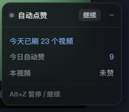

# 抖音自动点赞

一个用于网页版抖音的 Tampermonkey 用户脚本，视频播放后延迟 10 秒，通过 Z 键通道自动点赞，并自动跳过已点赞的视频。

## 特性

- 自动点赞当前正在观看的未点赞视频，覆盖推荐流、搜索结果、精选、播放页等页面。
- 延迟 10 秒再点赞：刷到不喜欢的视频可以直接划走，不会立刻被点赞；视频时长不足 10 秒的，阈值自动降至 3 秒，避免短视频播完还没轮到点赞。
- 已点赞的视频直接跳过（`data-e2e-state` 确认为已赞），不会误取消赞。
- 通过 Z 键事件触发点赞，与抖音页面自身的快捷键通道一致；结果由 `data-e2e-state` 迁移确认，只认这一个权威信号。
- 检测到手动取消点赞后不再干预该视频；滑走再滑回视为新的观看过程。
- 本次运行内每个视频只处理一次（刷新页面后重置）。
- 可将今日刷到的视频 ID 导出为 JSON，方便回看。


## 导出今日记录

Tampermonkey 菜单 →「导出今日刷视频数据」，会下载 `douyin_video_ids_YYYY-MM-DD.json`，内容形如：

```json
{
  "date": "2026-11-02",
  "total": 2,
  "ids": [
    "7xxxxxxxxxxxxxxxxxx",
    "7yyyyyyyyyyyyyyyyyy"
  ]
}
```

`id` 唯一取自视频自身祖先链上的 `data-e2e-vid`（通常落在 `feed-active-video` 或弹层容器上）。记录按天保存，跨天自动清零。

## 计数口径与手动取消点赞

面板上的「今日累计刷视频 N」统计的是**今日被脚本识别为当前观看对象的视频数量**，与是否点赞无关。

- 检测到你在当前视频上手动取消点赞后，脚本不再对这个视频发出点赞，直到你滑走再滑回（视为新的观看过程）。
- 取消后脚本不会自动补赞，避免与你的手动操作来回对抗。

## 实现要点

### 识别：多级证据解析器，而不是页面嗅探

`getCurrentVideo()` 按证据可信度降序尝试三层 resolver：

1. **平台标记**——抖音用 `feed-active-video` 自行标记当前视频。精选弹层页上平台会同时标记背景视频和弹层视频，靠"在播优先 + 可见面积"裁决。
2. **URL 匹配**——`modal_id` 与 DOM 节点 vid 精确一致时采信；dialog 中的候选还要求与 `modal_id` 身份一致，不一致即放弃。
3. **属性启发**——可见 + 在播 + 操作栏佐证，用于兜底。

身份纪律：视频 ID 只出自平台 DOM 标记（视频自身祖先的 `data-e2e-vid`）。`modal_id` 是 URL 上的身份标识，只用于精确匹配与一致性校验，**不参与 ID 生成或兜底**——resolver 只寻找两种身份的对应关系，不人为制造对应关系。

### 预览视频守卫

浏览页 hover 预览视频可能"在播 + 大尺寸"，仅靠 vid 祖先可能误判为当前视频。兜底路径要求容器内存在操作栏元素（`video-play-more`，实测：播放态容器有、预览容器无）才采信。

### 触发：延迟 + 到点重校验

排程时不置"已触发"，计时器到点才重新校验：仍是同一视频、脚本仍在运行、视频仍在播放、仍未点赞，任一不满足即放弃。默认延迟 10 秒；视频时长不足 10 秒时降至 3 秒——否则短视频在计时器到点前就已结束，永远轮不到点赞（`duration` 为 NaN 或 Infinity 时回落默认阈值）。Z 键发出后点赞是否真正生效，由 `data-e2e-state` 从未赞到已赞的迁移确认；"未生效"与"用户取消"的区分靠 `autoLikeRequested / autoLiked` 状态机，而不是回读时序猜测。

### 人工否决规则：仅当前停留生效

手动取消点赞只否决当前这次停留。滑走后旧会话（含计时器、否决标记）被清理，滑回同一视频视为新观看，允许重新排程点赞。

## 界面预览




## 温馨提示

抖音的「喜欢」会影响后续给你推什么内容，如替自己连续点了不少喜欢，之后刷到的内容也会发生变化。
具体会有什么影响不好说，介意的话，请谨慎使用本脚本。

## 安装

1. 安装 [Tampermonkey](https://www.tampermonkey.net/) 浏览器扩展（Chrome、Edge、Firefox 等）。
2. 点击下方链接，Tampermonkey 弹出安装确认页后，点击「安装」。

   [点击安装脚本](https://raw.githubusercontent.com/akunqwq/douyin-auto-like/main/douyin-auto-like.user.js)

如果没有自动弹出安装页，可以打开上述链接，复制脚本源码，再进入 Tampermonkey 的「添加新脚本」页面，粘贴并保存。

## 免责声明

本项目仅用于个人学习与浏览器自动化实验。脚本通过浏览器端操作触发交互，不主动请求抖音接口。

自动化操作可能违反目标网站的用户协议，请在使用前自行了解相关规则，并评估相应风险。请勿将本脚本用于刷量、养号等商业用途。使用本脚本产生的账号限制、封禁及其他损失，由使用者自行承担相应风险。

## 已知限制：不支持抖音页面内小窗

目前脚本面向抖音网页版的推荐流、搜索结果、精选、播放页等常规页面，抖音页面内的小窗模式尚未适配。

### 调查记录

通过devtools观察，我们可以看到：

- 小窗窗口的 URL 为 `about:blank`，`window === window.top` 为 `true`，且 `window.opener` 存在并可以访问原始抖音页面。
- 正常推荐流中的视频位于 `[data-e2e="feed-active-video"]` 容器内，并可读取 `data-e2e-vid`。
- 搜索结果页点开视频后，活动项位于 `[data-e2e="modal-video-container"]` 内（`id="dy-modal-video-container-search_multi_modal"`）。此时页面上会有 2 个 `feed-active-video`（背景推荐流 + 浮层），脚本取浮层内的那个。
- 抖音精选页的活动项位于 `[data-e2e="slideList"]` 内。
- 点赞按钮为 `[data-e2e="video-player-digg"]`，未赞 `data-e2e-state="video-player-no-digged"`，已赞 `data-e2e-state="video-player-is-digged"`。已赞时按钮会额外带上构建生成的 class（如 `Fw5w6T_O`），会随发版变化，不可用于判断。
- 播放器 class 不可靠：暂停时 `xgplayer-playing` 依然存在，会与 `xgplayer-pause`、`xgplayer-inactive` 同时出现，不能作为「正在播放」的依据。
- 曾考虑 `[data-e2e="video-info"]` 的 `data-e2e-aweme-id` 与 URL `modal_id` 作为视频 id 的备用来源，已否决：id 只出自视频祖先链的 `data-e2e-vid`，modal_id 仅用于匹配与一致性校验。理由：防止 URL 身份与 DOM 身份错配，宁可不点、不可错点。
- 进入小窗后，该容器在小窗文档中不存在，视频位于 `xg-video-container` 内。
- 正常推荐流与小窗中观察到相同的 `data-xgplayerid`、`blob:` 媒体地址和视频时长。这些现象提示播放器或媒体状态可能具有连续性，但尚不足以证明底层播放器实例始终相同。
- 当前小窗文档中没有脚本的悬浮面板。现有脚本使用的 `@match https://www.douyin.com/*` 不匹配 `about:blank`，因此不能假定脚本会自动在小窗中运行。

### 暂不适配的原因

现有实现依赖正常推荐流的活动视频容器和相关视频标识。小窗具有独立的文档上下文，DOM 结构也不同。仅修改视频选择器不足以保证倒计时连续、视频去重和点赞状态判断正确。

因此，当前版本暂不支持小窗模式。正常推荐流功能不受影响。

以上结论来自特定浏览器环境下的控制台观察，不代表抖音所有版本和小窗实现均具有完全相同的内部结构。

## 最后

如果本工具能帮到你，欢迎到 issues 讨论 ！

## 许可证

本项目采用 [MIT License](LICENSE) 许可。
