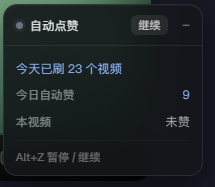

# 抖音推荐流自动点赞

一个用于网页版抖音推荐流的 Tampermonkey 用户脚本，通过模拟快捷键减少手动点赞操作，并自动跳过已点赞的视频。

## 特性

- 自动点赞推荐流中的未点赞视频。
- 跳过已点赞的视频，避免重复操作。
- 通过快捷键模拟交互，不直接请求抖音接口。

## 界面预览

## 温馨提示

抖音的「喜欢」会影响后续给你推什么内容，如替自己连续点了不少喜欢，之后刷到的内容也会发生变化。
具体会有什么影响不好说，介意的话，请谨慎使用本脚本。

## 安装

1. 安装 [Tampermonkey](https://www.tampermonkey.net/) 浏览器扩展（Chrome、Edge、Firefox 等）。
2. 点击下方链接，Tampermonkey 弹出安装确认页后，点击「安装」。

   [点击安装脚本](https://raw.githubusercontent.com/akunqwq/douyin-auto-like/main/douyin-auto-like.user.js)

如果没有自动弹出安装页，可以打开上述链接，复制脚本源码，再进入 Tampermonkey 的「添加新脚本」页面，粘贴并保存。

## 免责声明

本项目仅用于个人学习与浏览器自动化实验。脚本通过浏览器端操作触发交互，不主动请求抖音接口。

自动化操作可能违反目标网站的用户协议，请在使用前自行了解相关规则，并评估相应风险。请勿将本脚本用于刷量、养号等商业用途。使用本脚本产生的账号限制、封禁及其他损失，由使用者自行承担相应风险。

## 最后

如果本工具能帮到你，欢迎到 issues 讨论 ！

## 许可证

本项目采用 [MIT License](LICENSE) 许可。
